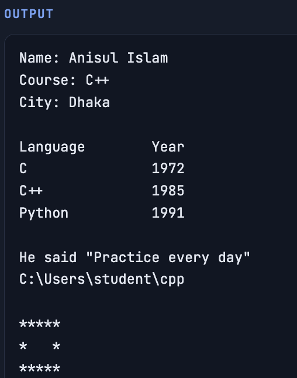
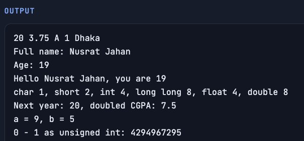

<a id="top"></a>

# C++ Tutorial Series: Assignments and Projects

Every module of the **Study With Anis** C++ course has one **assignment** and at least one **project**.
Work through them in order: each one uses only what you have learned up to that module.

- **Assignment:** several short tasks in one file, to practise each topic of the module.
- **Project:** one complete program that brings the module together.

## How to use this page

1. Watch the module's videos.
2. Do the **assignment**, then the **project**.
3. Compile with warnings on and fix every warning:

   ```bash
   g++ -std=c++20 -Wall -Wextra main.cpp -o main
   ./main
   ```

   On Windows, run `main.exe` instead of `./main`.

4. Compare your output with the screenshot in each section.

## Contents

| Module                                                       | Assignment                                         | Project                                                                                                                                                                                                                                               |
| ------------------------------------------------------------ | -------------------------------------------------- | ----------------------------------------------------------------------------------------------------------------------------------------------------------------------------------------------------------------------------------------------------- |
| [**1.** Introduction and Setup](#m01-module)                 | [Output and escape sequences](#m01-assignment)     | [Print a formatted profile card](#m01-project)                                                                                                                                                                                                        |
| [**2.** Variables, Data Types and Input/Output](#m02-module) | [Variables, data types and input](#m02-assignment) | [Student registration card](#m02-project)                                                                                                                                                                                                             |
| [**3.** Operators](#m03-module)                              | [Operators](#m03-assignment)                       | [Shop bill and change calculator](#m03-project)                                                                                                                                                                                                       |
| [**4.** Conditional Statements](#m04-module)                 | [Decisions with if and switch](#m04-assignment)    | [Menu-driven calculator](#m04-project)                                                                                                                                                                                                                |
| [**5.** Loops](#m05-module)                                  | [Loops](#m05-assignment)                           | [Pattern printer menu](#m05-project)                                                                                                                                                                                                                  |
| [**6.** Arrays and Strings](#m06-module)                     | [Arrays and strings](#m06-assignment)              | [Student marks application](#m06-project)                                                                                                                                                                                                             |
| [**7.** Functions](#m07-module)                              | [Functions](#m07-assignment)                       | [Guessing Game](#m07-project)                                                                                                                                                                                                                         |
| [**8.** Pointers and Memory](#m08-module)                    | [Pointers and memory](#m08-assignment)             | [Dynamic array class that grows](#m08-project)                                                                                                                                                                                                        |
| [**9.** Object-Oriented Programming (OOP)](#m09-module)      | [Object-oriented programming](#m09-assignment)     | 9.1. [Bank account class](#m09-project-1)<br>9.2. [Shape area calculator with polymorphism](#m09-project-2)                                                                                                                                           |
| [**10.** Templates and Exceptions](#m10-module)              | [Templates and exceptions](#m10-assignment)        | [Generic `Stack<T>` class template](#m10-project)                                                                                                                                                                                                     |
| [**11.** File Handling](#m11-module)                         | [Files](#m11-assignment)                           | [Contact book saved to a file](#m11-project)                                                                                                                                                                                                          |
| [**12.** Modern C++ Core](#m12-module)                       | [Modern C++](#m12-assignment)                      | [Modernize an old project](#m12-project)                                                                                                                                                                                                              |
| [**13.** STL and DSA](#m13-module)                           | [STL and DSA](#m13-assignment)                     | 13.1. [Library management with STL containers](#m13-project-1)<br>13.2. [City route finder](#m13-project-2)                                                                                                                                           |
| [**14.** Real Projects and Engineering](#m14-module)         | [A small engineered project](#m14-assignment)      | [Command line to-do app with CMake and tests](#m14-project)                                                                                                                                                                                           |
| [**15.** Final Projects](#m15-module)                        | ·                                                  | 15.1. [Library Management System](#m15-project-1)<br>15.2. [Inventory Management System](#m15-project-2)<br>15.3. [Hotel Management System](#m15-project-3)<br>15.4. [Console Snake Game](#m15-project-4)<br>15.5. [Mini Text Editor](#m15-project-5) |
| [**16.** C++26 and What's Next](#m16-module)                 | [C++26 exploration report](#m16-assignment)        | [Try one C++26 feature](#m16-project)                                                                                                                                                                                                                 |

---

<a id="m01-module"></a>

## Module 1: Introduction and Setup

<a id="m01-assignment"></a>

### Assignment 1: Output and escape sequences

**File:** `output.cpp`

Six small tasks in one file that practise everything from Module 1: `cout`, `endl`, escape sequences, comments and compiling with warnings on. Each step below is one task, in order.

**Tasks**

1. Print your details
2. A table with tabs
3. Quotes and a path
4. A box of stars
5. Comments
6. Compile with warnings on

**What you will practise**

- One `cout` can print several pieces
- `\n` and `endl` both end a line
- `\t` lines up columns
- Escape `"` and `\` inside strings
- Fix every warning

**Screenshot**



<a id="m01-project"></a>

### Project 1: Print a formatted profile card

**Goal:** Use `cout`, escape sequences and comments only.

**Steps**

1. Plan the card
2. Print the border and title
3. Line up labels with `\t`
4. Quotes and backslashes
5. Explain the parts with comments
6. Make it yours

**What you will practise**

- One `cout` per line of the card
- `\n` and `endl` end a line
- `\t` lines up columns
- `\"` and `\\` print special characters
- Comments explain the parts

**Screenshot**

<!-- Add the image to screenshots/module-01-project.png, then delete these comment markers:

-->

[Back to contents](#top)

---

<a id="m02-module"></a>

## Module 2: Variables, Data Types and Input/Output

<a id="m02-assignment"></a>

### Assignment 2: Variables, data types and input

**File:** `variables.cpp`

Six tasks on variables, data types, `cin`, `getline`, `sizeof`, `auto` and overflow. Uses only Module 1 and 2: no if statements or loops.

**Tasks**

1. One variable of each type
2. Read a full name and age
3. Sizes of types
4. `auto`
5. Swap two numbers
6. Unsigned wrap-around

**What you will practise**

- Pick the right type for each value
- `getline` for text with spaces
- `sizeof` shows memory use
- `auto` infers the type
- Unsigned values wrap around

**Screenshot**



<a id="m02-project"></a>

### Project 2: Student registration card

**Course:** C++ Programming, Module 2 (Variables, Data Types and Input/Output)<br>
**Level:** Beginner<br>
**Time:** 30 to 45 minutes

Read a student's details from the keyboard, store each one in the right data type, and print a neat registration card.

This project uses only what you learned in Modules 1 and 2. You don't need loops, `if` statements or arrays.

#### What you will practise

- Choosing a data type for each piece of information
- `string`, `int`, `double`, `char`, `unsigned short` and `long long`
- Reading input with `cin >>` and `getline`
- `const` and brace initialization `{}`
- `auto`
- Escape sequences `\n` and `\t` to line up the output

#### The task

Write a program that:

1. Stores the school name in a constant: `Study With Anis Academy`.
2. Asks the user for these details, one at a time:

   | Detail           | Example        | Data type to use                                       |
   | ---------------- | -------------- | ------------------------------------------------------ |
   | Full name        | `Rahim Uddin`  | `string` (read with `getline`, because it has a space) |
   | Age              | `20`           | `int`                                                  |
   | Height in metres | `1.72`         | `double`                                               |
   | Class            | `12`           | `unsigned short` (small and never negative)            |
   | Section          | `B`            | `char`                                                 |
   | Student ID       | `202600123456` | `long long` (12 digits is too big for `int`)           |

3. Works out next year's age with `auto`.
4. Prints the registration card exactly like the sample output below.

#### Sample run

What the user types is shown after each prompt.

```
Full name: Rahim Uddin
Age: 20
Height in metres: 1.72
Class: 12
Section: B
Student ID: 202600123456

+--------------------------------------+
  Study With Anis Academy
  STUDENT REGISTRATION CARD
+--------------------------------------+
  Name:		Rahim Uddin
  Age:		20 (next year 21)
  Height:	1.72 m
  Class:	12B
  Student ID:	202600123456
+--------------------------------------+
```

#### Starter code

Copy this into `main.cpp` and fill in each `TODO`.

```cpp
#include <iostream>
#include <string>
using namespace std;

int main() {
    // TODO 1: a const string called school, set with braces {}

    // TODO 2: declare name, age, height, classNo, section and studentId
    //         using the data types from the table

    // TODO 3: read the full name with getline

    // TODO 4: read age, height, class, section and student ID with cin >>

    // TODO 5: use auto to store age + 1 in nextAge

    // TODO 6: print the card. Use \t to line up the values

    return 0;
}
```

#### How to compile and run

```bash
g++ -std=c++20 -Wall -Wextra main.cpp -o main
./main
```

On Windows, run `main.exe` instead of `./main`.

#### Hints

- **Read the name first.** `getline(cin, name);` reads the whole line, spaces included. If you used `cin >> name`, it would stop at the first space and you'd get only `Rahim`.
- **Lining up with tabs.** `\t` jumps to the next tab stop, which comes every 8 columns. A short label like `"  Name:"` needs two tabs (`\t\t`); a longer one like `"  Height:"` needs one.
- **Class and section together.** Print `classNo` and then `section` with nothing between them, and you get `12B`.
- **`char` uses single quotes.** `'B'` is a `char`, but `"B"` is a `string`.
- **Why `long long`?** The largest `int` on most computers is `2147483647` (10 digits). A 12-digit ID doesn't fit and would overflow.

#### Checklist before you submit

- [ ] The school name is a `const` set with braces
- [ ] Every detail uses the data type from the table
- [ ] A full name with a space is read correctly
- [ ] `nextAge` is declared with `auto`
- [ ] The output matches the sample, with values lined up in one column
- [ ] The program compiles with `-Wall -Wextra` and shows no warnings

#### Extra challenges

Try these when the main task works:

1. Add a blood group (`string`) and a guardian's phone number. Should the phone number be a `string` or a number? Why?
2. Print the height in centimetres as well (`height * 100`).
3. Add a `const int` for the current year and print the student's birth year (`year - age`).
4. Print the size in bytes of each variable with `sizeof`, for example `sizeof(studentId)`.
5. If your compiler supports C++23, print the card with `std::print` instead of `cout`.

**Screenshot**

<!-- Add the image to screenshots/module-02-project.png, then delete these comment markers:

-->

[Back to contents](#top)

---

<a id="m03-module"></a>

## Module 3: Operators

<a id="m03-assignment"></a>

### Assignment 3: Operators

**File:** `operators.cpp`

Seven tasks on arithmetic, formatting, assignment, increment, relational, logical, bitwise and the ternary operator. No if statements yet: decisions use the ternary operator.

**Tasks**

1. Arithmetic on two numbers
2. Rectangle with two decimals
3. Celsius to Fahrenheit
4. Pre and post increment
5. Relational and logical
6. Even or odd with the ternary operator
7. Bitwise tricks

**What you will practise**

- int / int drops the decimals
- % gives the remainder
- Format money and areas with setprecision
- Post increment returns the old value
- The ternary operator chooses a value

**Screenshot**

<!-- Add the image to screenshots/module-03-assignment.png, then delete these comment markers:

-->

<a id="m03-project"></a>

### Project 3: Shop bill and change calculator

**Goal:** Read a product's price, quantity, discount and the amount paid. Print a bill with discount, 5% VAT and total, break the change into taka notes, and show a few yes/no facts. No `if`, no ternary operator and no logical operators.

**Steps**

1. Read the input
2. Work out the bill
3. Print with two decimals
4. Break the change into notes
5. Yes/no facts
6. Increment for a bonus item

**What you will practise**

- `/` and `%` split an amount into notes
- `%=` updates the remaining amount
- Use `100.0` to avoid integer division
- Relational operators give `true` or `false`
- `fixed` and `setprecision(2)` for money

**Sample run**

    Unit price: 120.50
    Quantity: 12
    Discount %: 10
    Amount paid: 2000

    ----------- BILL -----------
    Subtotal:   1446.00
    Discount:   -144.60
    VAT 5%:     65.07
    Total:      1366.47
    Payable:    1366 taka
    Change:     634 taka
    Notes: 500x1 100x1 50x0 20x1 10x1 5x0 2x2 1x0
    Items in bag (with 1 free sample): 13
    Paid enough: true
    Free delivery (1000 or more): true
    Bulk order (10 or more): true

**Screenshot**

<!-- Add the image to screenshots/module-03-assignment.png, then delete these comment markers:

-->

[Back to contents](#top)

---

<a id="m04-module"></a>

## Module 4: Conditional Statements

<a id="m04-assignment"></a>

### Assignment 4: Decisions with if and switch

**File:** `conditions.cpp`

Six classic decision problems that use if, else if, nested if and `switch`. Each one reads its own input.

**Tasks**

1. Positive, negative or zero
2. Grade from marks
3. Largest of three
4. Leap year
5. Day name with `switch`
6. Electricity bill

**What you will practise**

- Order ladder conditions from highest to lowest
- Use && to compare against several values
- `switch` needs break after each case
- default handles bad input

**Screenshot**

<!-- Add the image to screenshots/module-04-assignment.png, then delete these comment markers:

-->

<a id="m04-project"></a>

### Project 4: Menu-driven calculator

**Goal:** Use `switch` for the menu and if-else to check bad input such as division by zero.

**Steps**

1. The loop
2. `switch` on the choice
3. Guard against bad input
4. `do-while` fits menus

**What you will practise**

- `do-while` for menus
- `switch` for the operation
- Check division by zero
- break leaves the loop on exit

**Screenshot**

<!-- Add the image to screenshots/module-04-project.png, then delete these comment markers:

-->

[Back to contents](#top)

---

<a id="m05-module"></a>

## Module 5: Loops

<a id="m05-assignment"></a>

### Assignment 5: Loops

**File:** `loops.cpp`

Seven tasks with `for`, `while` and `do-while` loops: sums, factorial, digits, primes, Fibonacci, a pattern and a menu.

**Tasks**

1. Sum of 1 to n
2. Factorial
3. Sum and reverse of digits
4. Prime check
5. First n Fibonacci numbers
6. Right triangle of stars
7. Menu with `do-while`

**What you will practise**

- `for` when you know the count
- `while` when you wait for a condition
- `do-while` runs at least once
- `% 10` and `/ 10` walk through digits
- Check divisors only up to the square root

**Screenshot**

<!-- Add the image to screenshots/module-05-assignment.png, then delete these comment markers:

-->

<a id="m05-project"></a>

### Project 5: Pattern printer menu

**Goal:** Let the user pick a pattern and a size, then print it with nested loops.

**Steps**

1. One function per pattern
2. Diamond = pyramid + inverted pyramid
3. Menu loop

**What you will practise**

- Break the program into small functions
- Reuse a row function for several shapes
- `do-while` + `switch` for menus

**Screenshot**

<!-- Add the image to screenshots/module-05-project.png, then delete these comment markers:

-->

[Back to contents](#top)

---

<a id="m06-module"></a>

## Module 6: Arrays and Strings

<a id="m06-assignment"></a>

### Assignment 6: Arrays and strings

**File:** `arrays.cpp`

Seven tasks with plain arrays, a 2D array and `std::string`, written with loops only (no STL algorithms).

**Tasks**

1. Read n numbers, print sum and average
2. Largest and smallest with positions
3. Count even and odd
4. Reverse in place
5. 3 x 3 matrix
6. Count vowels
7. Uppercase without a library

**What you will practise**

- Indexes go from 0 to n - 1
- Track the index, not just the value, to report positions
- Swap with a temporary variable
- m[i][i] is the main diagonal
- Characters are small numbers (ASCII)

**Screenshot**

<!-- Add the image to screenshots/module-06-assignment.png, then delete these comment markers:

-->

<a id="m06-project"></a>

### Project 6: Student marks application

**Goal:** A program that reads names and marks for several students, then prints a report: each student's total, average and grade, the class topper and subject averages.

**Steps**

1. Plan the data
2. Read the data
3. Compute and find the topper
4. Subject averages

**What you will practise**

- Plan the data layout first
- Rows are students, columns are subjects
- Row sums for totals, column sums for subject averages
- Split work into functions like grade()

**Screenshot**

<!-- Add the image to screenshots/module-06-project.png, then delete these comment markers:

-->

[Back to contents](#top)

---

<a id="m07-module"></a>

## Module 7: Functions

<a id="m07-assignment"></a>

### Assignment 7: Functions

**File:** `functions.cpp`

Seven small functions that practise return values, references, overloading, default parameters, recursion, passing arrays and `constexpr`.

**Tasks**

1. isPrime
2. Swap by reference
3. Overloaded area
4. Default parameter
5. Recursion
6. Pass an array
7. `constexpr`

**What you will practise**

- A function does one job and returns a result
- & lets a function change the caller's variable
- Overloads differ by parameters
- Every recursion needs a base case
- Pass the size along with an array

**Screenshot**

<!-- Add the image to screenshots/module-07-assignment.png, then delete these comment markers:

-->

<a id="m07-project"></a>

### Project 7: Guessing Game

**Goal:** The computer picks a secret number from 1 to 100 and the player guesses until they find it, with 'too high' or 'too low' hints and an attempt counter.

**Steps**

1. Pick a secret number
2. Loop until correct
3. Why 7 guesses are enough
4. Functions keep it tidy

**What you will practise**

- Seed once, pick a number per round
- `do-while` fits the guessing loop
- Middle guesses find any number in 7 tries

**Screenshot**

<!-- Add the image to screenshots/module-07-project.png, then delete these comment markers:

-->

[Back to contents](#top)

---

<a id="m08-module"></a>

## Module 8: Pointers and Memory

<a id="m08-assignment"></a>

### Assignment 8: Pointers and memory

**File:** `pointers.cpp`

Seven tasks on addresses, pointers, pointer arithmetic, `new` and delete, smart pointers and `nullptr`.

**Tasks**

1. Address and value
2. Swap with pointers
3. Pointer arithmetic
4. Dynamic array
5. `unique_ptr`
6. `shared_ptr`
7. `nullptr`

**What you will practise**

- & gives an address, \* follows it
- Arrays decay to a pointer to the first element
- Every new[] needs one `delete[]`
- Prefer smart pointers to raw `new` and delete
- Check for `nullptr` before using a pointer

**Screenshot**

<!-- Add the image to screenshots/module-08-assignment.png, then delete these comment markers:

-->

<a id="m08-project"></a>

### Project 8: Dynamic array class that grows

**Goal:** Allocate with new, grow when full, free in the destructor. This is how vector works inside.

**Steps**

1. Members
2. push_back with doubling
3. Why amortised O(1)
4. Destructor and the rule of three

**What you will practise**

- size = used, capacity = allocated
- Doubling makes push_back amortised O(1)
- The destructor frees the buffer
- Classes that own memory need care with copying

**Screenshot**

<!-- Add the image to screenshots/module-08-project.png, then delete these comment markers:

-->

[Back to contents](#top)

---

<a id="m09-module"></a>

## Module 9: Object-Oriented Programming (OOP)

<a id="m09-assignment"></a>

### Assignment 9: Object-oriented programming

**File:** `oop.cpp`

Build a small school model with classes: encapsulation, constructors, `const` member functions, inheritance, `virtual` functions, operator overloading and `enum class`.

**Tasks**

1. A Student class
2. `enum class` for grades
3. Base and derived classes
4. Polymorphism
5. Operator overloading
6. this

**What you will practise**

- Keep data private; check values in setters
- Use the initializer list in constructors
- Mark functions that do not change the object `const`
- `virtual` + `override` for polymorphism
- A base class with `virtual` functions needs a `virtual` destructor

**Screenshot**

<!-- Add the image to screenshots/module-09-assignment.png, then delete these comment markers:

-->

<a id="m09-project-1"></a>

### Project 9.1: Bank account class

**Goal:** Deposit, withdraw and show balance. Keep the balance private.

**Steps**

1. Design
2. Static member for numbering
3. History
4. Transfer

**What you will practise**

- Private data, public operations
- Static members are shared by all objects
- Keep a history for auditing
- Validate every operation

**Screenshot**

<!-- Add the image to screenshots/module-09-project-1.png, then delete these comment markers:

-->

<a id="m09-project-2"></a>

### Project 9.2: Shape area calculator with polymorphism

**Goal:** A menu program that lets the user add circles, rectangles and triangles, stores them as `unique_ptr`&lt;Shape&gt;, and prints each area and the total using `virtual` functions.

**Steps**

1. The interface
2. A factory function
3. Process them all

**What you will practise**

- Abstract base + concrete shapes
- A factory hides which class is created
- One loop handles every shape

**Screenshot**

<!-- Add the image to screenshots/module-09-project-2.png, then delete these comment markers:

-->

[Back to contents](#top)

---

<a id="m10-module"></a>

## Module 10: Templates and Exceptions

<a id="m10-assignment"></a>

### Assignment 10: Templates and exceptions

**File:** `templates.cpp`

Six tasks with function templates, a class template, exceptions, concepts and `noexcept`.

**Tasks**

1. maxOf template
2. Template with two types
3. Class template
4. Exceptions
5. A concept
6. `noexcept`

**What you will practise**

- Templates let the compiler write a version per type
- Throw when you cannot continue; catch where you can handle it
- Catch by `const` reference
- Concepts give clear errors for wrong types
- `noexcept` documents and enables optimisations

**Screenshot**

<!-- Add the image to screenshots/module-10-assignment.png, then delete these comment markers:

-->

<a id="m10-project"></a>

### Project 10: Generic `Stack<T>` class template

**Goal:** Push, pop and top for any type. Throw an exception on pop from an empty stack.

**Steps**

1. Design
2. The template
3. Use: balanced brackets
4. Use: undo history

**What you will practise**

- A stack is LIFO
- vector's back is a natural top
- Templates make one Stack for every type
- Throw on pop/top of an empty stack

**Screenshot**

<!-- Add the image to screenshots/module-10-project.png, then delete these comment markers:

-->

[Back to contents](#top)

---

<a id="m11-module"></a>

## Module 11: File Handling

<a id="m11-assignment"></a>

### Assignment 11: Files

**File:** `files.cpp`

Six tasks that write, read, append and inspect files with fstream and `std::filesystem`.

**Tasks**

1. Write students to a file
2. Read it back line by line
3. Append
4. Count lines and words
5. Check the file opened
6. `std::filesystem`

**What you will practise**

- ofstream writes, ifstream reads
- Opening with ofstream empties the file unless you use `ios::app`
- Always check that a file opened
- Files close automatically at the end of their scope
- `std::filesystem` answers questions about files and folders

**Screenshot**

<!-- Add the image to screenshots/module-11-assignment.png, then delete these comment markers:

-->

<a id="m11-project"></a>

### Project 11: Contact book saved to a file

**Goal:** Add, search and delete contacts. Load the file when the program starts.

**Steps**

1. Design
2. Load on start, save on change
3. Search
4. Delete

**What you will practise**

- Keep data and file in sync
- Load in the constructor, save after each change
- erase-remove_if for deleting
- Case-insensitive search with tolower

**Screenshot**

<!-- Add the image to screenshots/module-11-project.png, then delete these comment markers:

-->

[Back to contents](#top)

---

<a id="m12-module"></a>

## Module 12: Modern C++ Core

<a id="m12-assignment"></a>

### Assignment 12: Modern C++

**File:** `modern.cpp`

Seven tasks with lambdas, optional, variant, structured bindings, ranges, `constexpr` and move semantics.

**Tasks**

1. Lambdas
2. `std::optional`
3. `std::variant`
4. Structured bindings
5. Ranges and views
6. `constexpr`
7. Move semantics

**What you will practise**

- Lambdas are small unnamed functions
- optional says 'maybe no result' without -1 tricks
- variant is a type-safe union
- Structured bindings name the parts of a pair or struct
- Views are lazy pipelines
- After `std::move`, do not rely on the old value

**Screenshot**

<!-- Add the image to screenshots/module-12-assignment.png, then delete these comment markers:

-->

<a id="m12-project"></a>

### Project 12: Modernize an old project

**Goal:** Take an earlier project and rewrite it with `auto`, lambdas, range-for and smart pointers.

**Steps**

1. Spot the old patterns
2. Replace memory management
3. Use algorithms
4. Return optional instead of -1
5. Check behaviour is unchanged

**What you will practise**

- vector and string remove manual memory
- Algorithms replace hand-written loops
- optional replaces magic values
- Always compare old and new outputs

**Screenshot**

<!-- Add the image to screenshots/module-12-project.png, then delete these comment markers:

-->

[Back to contents](#top)

---

<a id="m13-module"></a>

## Module 13: STL and DSA

<a id="m13-assignment"></a>

### Assignment 13: STL and DSA

**File:** `stl.cpp`

Seven tasks that combine STL containers and algorithms with classic DSA ideas: sorting, frequency counting, hashing, stacks, BFS, binary search and heaps.

**Tasks**

1. Sort and remove duplicates
2. Word frequency
3. First non-repeating character
4. Balanced brackets
5. BFS shortest path
6. Binary search with `lower_bound`
7. Top 3 with `priority_queue`

**What you will practise**

- sort + unique + erase removes duplicates
- map is ordered, `unordered_map` is faster
- A stack matches nested brackets
- BFS finds the shortest path in an unweighted graph
- A size-k min-heap keeps the k largest values

**Screenshot**

<!-- Add the image to screenshots/module-13-assignment.png, then delete these comment markers:

-->

<a id="m13-project-1"></a>

### Project 13.1: Library management with STL containers

**Goal:** Books in a vector, quick lookup with `unordered_map`, borrow queue with queue.

**Steps**

1. Choose containers
2. Borrow
3. Return
4. Reports

**What you will practise**

- Pick a container per requirement
- Hash map for fast lookup by key
- Queue for fair waiting order
- Set to track a changing group

**Screenshot**

<!-- Add the image to screenshots/module-13-project-1.png, then delete these comment markers:

-->

<a id="m13-project-2"></a>

### Project 13.2: City route finder

**Goal:** Store roads in an adjacency list and find the shortest path between two places with BFS.

**Steps**

1. Map city names to numbers
2. BFS with parents
3. Weighted roads: Dijkstra

**What you will practise**

- Map names to ids for graph code
- BFS finds the fewest edges
- parent[] rebuilds the path
- Dijkstra for weighted shortest paths

**Screenshot**

<!-- Add the image to screenshots/module-13-project-2.png, then delete these comment markers:

-->

[Back to contents](#top)

---

<a id="m14-module"></a>

## Module 14: Real Projects and Engineering

<a id="m14-assignment"></a>

### Assignment 14: A small engineered project

**File:** `calculator`

Split a small calculator into a header, a source file and main, build it with CMake, test it with assert, and use two threads to sum a large range safely.

**Tasks**

1. Header and source files
2. CMakeLists.txt
3. Simple tests
4. Two threads
5. Format and check
6. Commit with Git

**What you will practise**

- Headers declare, source files define
- CMake describes the build once
- Tests catch mistakes early
- Shared data between threads needs `atomic` or a mutex
- `jthread` joins by itself at the end of its scope

**Screenshot**

<!-- Add the image to screenshots/module-14-assignment.png, then delete these comment markers:

-->

<a id="m14-project"></a>

### Project 14: Command line to-do app with CMake and tests

**Goal:** Build with CMake, test with GoogleTest, keep it on GitHub.

**Steps**

1. Project layout
2. Commands
3. Build, test, format, commit

**What you will practise**

- Separate logic (library) from I/O (CLI)
- Test the library, not the console
- Use the full build/test/format/commit loop

**Screenshot**

<!-- Add the image to screenshots/module-14-project.png, then delete these comment markers:

-->

[Back to contents](#top)

---

<a id="m15-module"></a>

## Module 15: Final Projects

<a id="m15-project-1"></a>

### Project 15.1: Library Management System

**Goal:** A complete console library system: books and members as classes, borrowing with limits and due dates, fines for late returns, search by title, and saving everything to files.

**Steps**

1. Requirements
2. Class design
3. Borrow rules
4. Search
5. Save and load

**What you will practise**

- Model data with structs/classes, rules in one class
- maps keyed by id for lookups
- Every rule checked before changing state
- Save in a simple text format

**Screenshot**

<!-- Add the image to screenshots/module-15-project-1.png, then delete these comment markers:

-->

<a id="m15-project-2"></a>

### Project 15.2: Inventory Management System

**Goal:** Track products, stock levels and sales: add products, restock, sell with stock checks, report low-stock items, and compute total stock value and best sellers.

**Steps**

1. Data
2. Sell with checks
3. Reports
4. Formatted output

**What you will practise**

- Validate every stock change
- Keep derived data (low stock) updated in one place
- Sort pointers to avoid copying objects
- Format reports with iomanip

**Screenshot**

<!-- Add the image to screenshots/module-15-project-2.png, then delete these comment markers:

-->

<a id="m15-project-3"></a>

### Project 15.3: Hotel Management System

**Goal:** Manage rooms, bookings and bills: rooms of different types with nightly rates, bookings that must not overlap, check-out with a bill, and an occupancy report.

**Steps**

1. Rooms and bookings
2. Overlap check
3. Find a free room
4. Bill

**What you will practise**

- Use half-open ranges [in, out)
- Overlap test: a &lt; d && c &lt; b
- Check availability before booking
- Keep bills derived from booking data

**Screenshot**

<!-- Add the image to screenshots/module-15-project-3.png, then delete these comment markers:

-->

<a id="m15-project-4"></a>

### Project 15.4: Console Snake Game

**Goal:** Build the logic of Snake: a grid, a snake stored in a deque, food, movement, growing and collision detection, drawn as text.

**Steps**

1. Game state
2. One step
3. Collision with the body
4. Drawing
5. Real-time input

**What you will practise**

- deque: push the new head, pop the tail
- Grow by not popping the tail
- Check walls and body before moving
- Separate game logic from input and drawing

**Screenshot**

<!-- Add the image to screenshots/module-15-project-4.png, then delete these comment markers:

-->

<a id="m15-project-5"></a>

### Project 15.5: Mini Text Editor

**Goal:** A line-based text editor in the spirit of ed: open a file into a vector of lines, then type commands to print, append, insert, delete, replace, search, undo and save.

**Steps**

1. The buffer
2. Commands
3. Undo with a stack
4. Substitute everywhere
5. Validate line numbers

**What you will practise**

- vector&lt;string&gt; as a line buffer
- Snapshots on a stack give undo
- Validate every line number
- Advance past replacements to avoid loops

**Screenshot**

<!-- Add the image to screenshots/module-15-project-5.png, then delete these comment markers:

-->

[Back to contents](#top)

---

<a id="m16-module"></a>

## Module 16: C++26 and What's Next

<a id="m16-assignment"></a>

### Assignment 16: C++26 exploration report

Research and try one C++26 feature, then write a one-page report comparing it with how you would solve the same problem in C++20. Features and compiler support change quickly, so check current sources and use Compiler Explorer with a trunk compiler.

**Tasks**

1. Make a feature table
2. Try one feature
3. Solve it in C++20
4. Compare
5. Write the report
6. Share

**What you will practise**

- Separate what is standard from what is experimental
- Always note the compiler and version you used
- Compare against a C++20 solution
- Keep the example small

**Screenshot**

<!-- Add the image to screenshots/module-16-assignment.png, then delete these comment markers:

-->

<a id="m16-project"></a>

### Project 16: Try one C++26 feature

**Goal:** Test it on Compiler Explorer and explain the result in a short video.

**Steps**

1. Pick a feature
2. Write the old and new version
3. Report support with feature-test macros
4. Share it

**What you will practise**

- Pick a feature your compiler supports
- Show old vs new code
- Use feature-test macros
- Compare compilers on Compiler Explorer

**Screenshot**

<!-- Add the image to screenshots/module-16-project.png, then delete these comment markers:

-->

[Back to contents](#top)

---

Made for the **Study With Anis** C++ course.<br>
YouTube: [@anisul-islam](https://www.youtube.com/@anisul-islam) · Facebook: [studywithanis](https://www.facebook.com/studywithanis)
